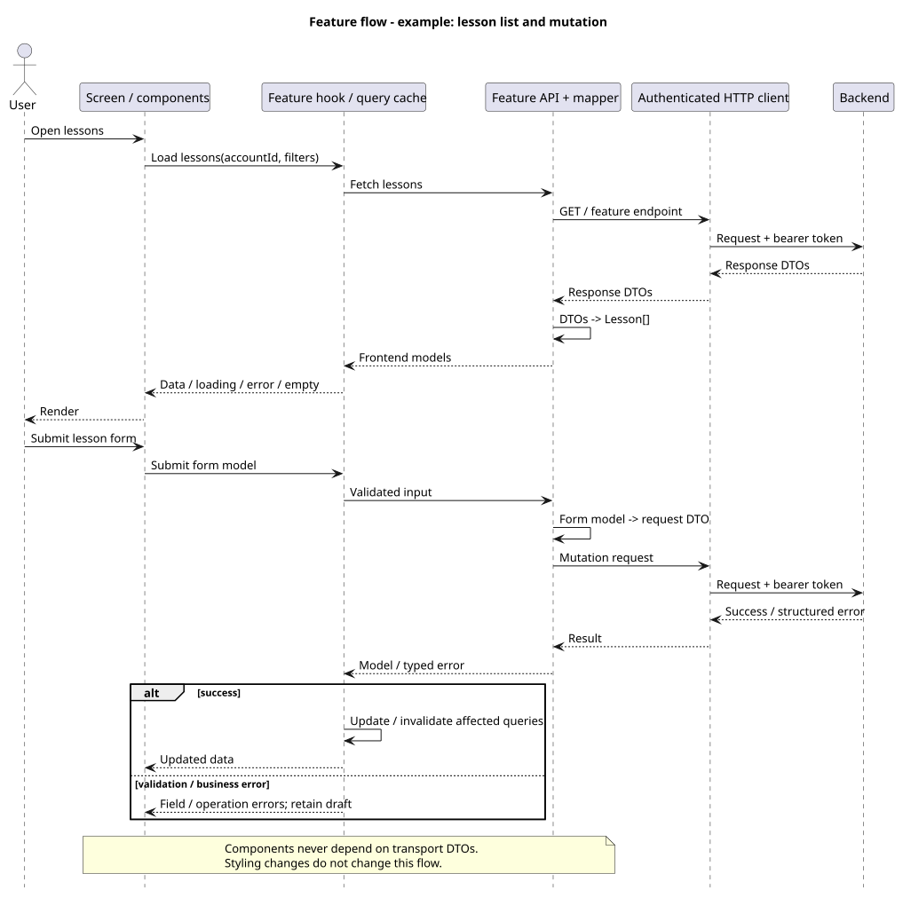

# Mobile architecture

**Agreed target architecture** — Android/iOS + web. Implementation is tracked separately.

Related issue: [#161 — Frontend architecture and project structure](https://github.com/JStec0312/Tutoring-CRM-System/issues/161).

**Current implementation:** [session and login walkthrough](../session/README.md) — startup, restoration, login, refresh and logout.

**Earlier design example:** [application flow](application-flow.md).

**Implemented foundation:** [session implementation](session-implementation.md). Business feature folders are placeholders; OpenAPI generation is not configured yet.

## Structure

```text
src/
  bootstrap/              # composition root: wires auth, storage and HTTP client
  app/                    # routes, layouts, providers, dependency wiring
  features/
    auth/                 # login, logout, session bootstrap
    lessons/              # same structure for other business features
      api/                # endpoint calls + DTO mappers
      models/             # frontend models + form schemas
      hooks/              # queries, mutations, behavior
      components/         # UI
  shared/
    api/                  # HTTP client + generated OpenAPI DTOs
    session/              # session state + platform token storage
    ui/                   # reusable UI primitives
```

`app → features → shared`. Cross-feature access uses public exports; no cycles. `shared` never imports features. `app` injects refresh callbacks into the HTTP client.

[Module diagram](diagrams/modules.svg) · [PlantUML](diagrams/modules.puml)

## Data flow



- Components use frontend models, never API DTOs or tokens.
- Contract shape changes affect generated DTOs and feature mappers. Business changes may affect UI.
- Query cache is account-scoped; mutations update/invalidate affected queries.
- Development: **API + mapping → functional unstyled screen → UI refinement**. Handle loading, empty, error and pending states immediately.

[PlantUML](diagrams/feature-flow.puml)

Example: `features/lessons/api/get-lessons.ts` (illustrative DTO fields).

```ts
// Transport type: generated from OpenAPI.
type LessonDto = { id: string; scheduledStart: string };
// Frontend model: owned by features/lessons/models.
type Lesson = { id: string; startsAt: Date };

const toLesson = (dto: LessonDto): Lesson => ({
  id: dto.id,
  startsAt: new Date(dto.scheduledStart),
});

async function getLessons(): Promise<Lesson[]> {
  const dtos = await api.get<LessonDto[]>("/api/lessons");
  return dtos.map(toLesson);
}
```
