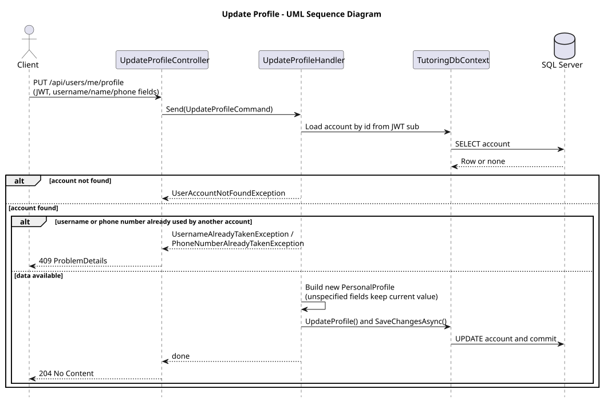

> As a user, I want to edit my profile data and password so that my account information stays up to date.

## Scope

An authenticated user can read their first name, last name and phone number, and update those fields and their username. The signed-in password change verifies the current password. The reset-token flow continues to support users who cannot sign in.

## FILES

- Implementation: [UpdateProfile](../../../../../TutoringManagementSystem/Tutoring.Api/Features/Users/UpdateProfile/), [RequestPasswordReset](../../../../../TutoringManagementSystem/Tutoring.Api/Features/Auth/RequestPasswordReset/), [ResetPassword](../../../../../TutoringManagementSystem/Tutoring.Api/Features/Auth/ResetPassword/)
- Tests: [UpdateProfile](../../../../../TutoringManagementSystem/Tutoring.IntegrationTests/Features/Users/UpdateProfile/), [RequestPasswordReset](../../../../../TutoringManagementSystem/Tutoring.IntegrationTests/Features/Auth/RequestPasswordReset/), [ResetPassword](../../../../../TutoringManagementSystem/Tutoring.IntegrationTests/Features/Auth/ResetPassword/)

## API

| Method | Endpoint | Auth | Result |
| --- | --- | --- | --- |
| GET | `/api/users/me/profile` | JWT | Returns first name, last name and phone number for the authenticated account. |
| PUT | `/api/users/me/profile` | JWT | Updates username/name/phone for the authenticated account, returns `204 No Content`. |
| PUT | `/api/users/me/password` | JWT | Verifies `currentPassword`, applies the password policy to `newPassword` and returns `204 No Content`. An incorrect current password returns `400 Auth.IncorrectCurrentPassword`. |
| POST | `/api/auth/password-reset/request` | Anonymous | Emails a reset link if the account exists and is active; always returns `204 No Content`. |
| POST | `/api/auth/password-reset` | Anonymous (reset token) | Sets a new password for a valid, unused, unexpired token, returns `204 No Content`. |

## Implementation

- Profile updates preserve the username when omitted. Null first name, last name or phone number clears the field. The endpoint checks username and phone uniqueness against other accounts.
- A signed-in password change saves the new hash and revokes active refresh and unused password reset tokens in the same transaction. Existing access tokens expire on their original schedule.
- `RequestPasswordResetHandler` invalidates a user's other active reset tokens and creates a new one, saved with a `PasswordResetRequested` outbox event in the same transaction. It responds identically for unknown emails and inactive accounts to avoid leaking account existence.
- The outbox/RabbitMQ/email pipeline mirrors registration: `OutboxProcessor` → RabbitMQ → `EmailConsumer` → `EmailEventDispatcher` → `SmtpMailer`.
- The email handler reads the frontend page URL from `PasswordReset:ResetUrl` and appends the encoded token. The local default targets Expo Web at `http://localhost:8081/reset-password`. Override it with `PasswordReset__ResetUrl` when deploying.
- `ResetPasswordHandler` validates the token hash, enforces the password policy, then changes the password, marks the token used, revokes all of the user's active refresh tokens (forces re-login everywhere), and invalidates the user's other active reset tokens.
- Invalid, expired, or already-used reset tokens return `401 Auth.InvalidPasswordResetToken`.

## Diagram

## Tests

`Tutoring.IntegrationTests`: profile update requiring authentication, successful update, username/phone conflicts; password-reset request token/outbox creation, the configured URL in the rendered email, and inactive/unknown-account handling; password reset with valid/used/unknown/expired/invalidated tokens, policy violations, and refresh-token/reset-token invalidation side effects.
