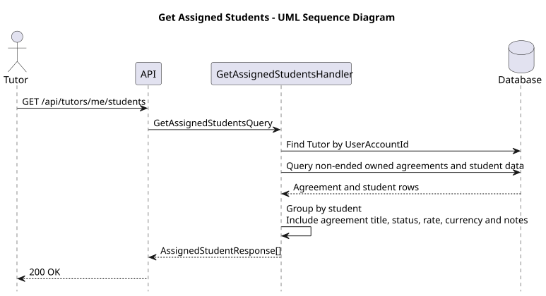

# US-005 — Get assigned students

> As a tutor, I want to see my assigned students so that I can manage the people I teach.

## Scope

`GET /api/tutors/me/students` returns students with at least one non-ended agreement owned by the authenticated tutor. Each student appears once with all of their non-ended agreements for that tutor.

The endpoint requires the `Tutor` role. It returns `401 Unauthorized` for missing authentication or an invalid JWT subject and `403 Forbidden` for other roles. A tutor with no matching agreements receives `200 OK` with an empty list.

## FILES

- Implementation: [GetAssignedStudents](../../../../../TutoringManagementSystem/Tutoring.Api/Features/Tutors/GetAssignedStudents/)
- Tests: [GetAssignedStudents](../../../../../TutoringManagementSystem/Tutoring.IntegrationTests/Features/Tutors/GetAssignedStudents/)

## Implementation

- The caller's `sub` claim is resolved to `UserAccountId` and passed in `GetAssignedStudentsQuery`.
- `GetAssignedStudentsHandler` looks up the `Tutor` by `UserAccountId`. If no tutor exists, an empty list is returned.
- Students are resolved through `TutoringAgreement` rows where `TutorId` belongs to the authenticated tutor and `Status != AgreementStatus.Ended`.
- The response contains one `AssignedStudentResponse` per student. Its top-level `status` is the student status.
- Student-level data is resolved from the `Student` entity and its associated `UserAccount`.
- `Email` is returned from `Student.Account.Email`.
- `PhoneNumber` is returned from `Student.Account.Profile.PhoneNumber`.
- `FirstName` and `LastName` are also resolved from the student's account profile.
- Agreement-specific data is returned in the `Agreements` collection as `StudentAgreementResponse`.
- Each agreement contains its title, subject, agreement status, hourly rate, currency code, and tutor-maintained private notes. The rate and currency are null when no rate has been set. T02 filters students using the nested agreement status.
- Managed students without a `UserAccount` have `null` account-derived fields such as first name, last name, email, and phone number, while their tutoring agreements are still returned normally.
- Ended agreements and agreements belonging to other tutors are excluded.

## Response structure

```text
AssignedStudentResponse
├── StudentId
├── DisplayName
├── FirstName
├── LastName
├── Email
├── PhoneNumber
├── Status
└── Agreements[]
    ├── TutoringAgreementId
    ├── Title
    ├── Subject
    ├── Status
    ├── HourlyRate
    ├── Currency
    └── Notes
```

## Diagram



[Assigned students PlantUML source](diagrams/get_assigned_students.puml)

## Tests

`Tutoring.IntegrationTests.Features.Tutors.GetAssignedStudents.GetAssignedStudentsTests` covers:

- missing access token (`401`),
- `Student` role caller (`403`),
- tutor with no assignments (`200` with an empty list),
- registered student response mapping, including account contact details and agreement title, status, and currency,
- managed student response mapping with `null` account-derived fields,
- registered and managed students returned together,
- tutor data isolation,
- exclusion of `Ended` agreements,
- multiple active agreements for the same student being returned as one student with multiple entries in the `Agreements` collection.
