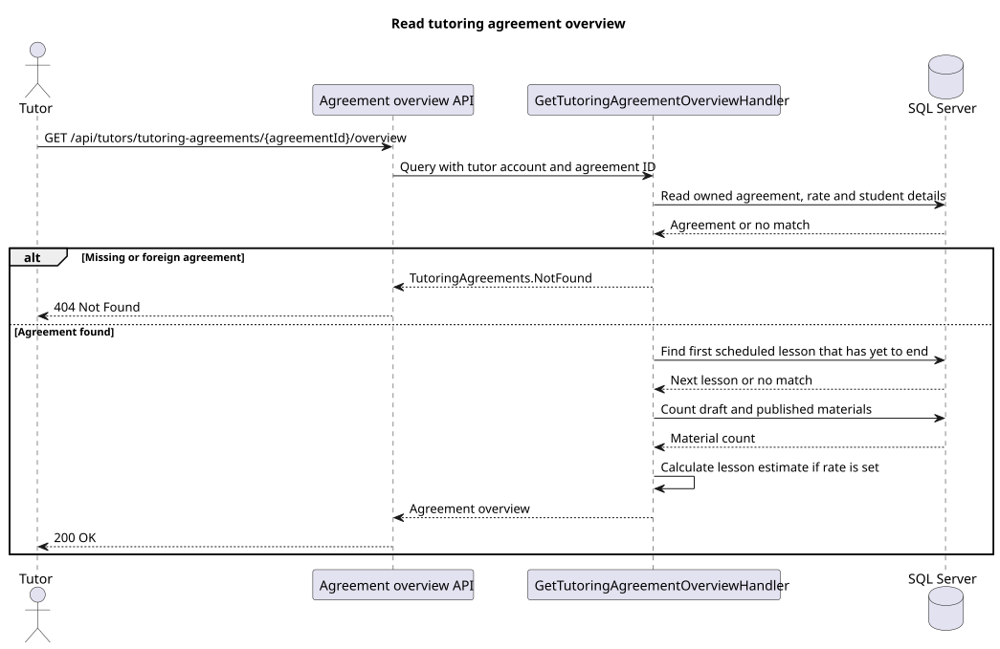

# [US-007] Update tutoring agreement details

> As a tutor, I want to store subject and notes for each tutoring agreement so that I can keep cooperation-specific information in one place.

## Scope

An authenticated tutor can read the overview of an owned tutoring agreement and update its subject and private notes while the agreement is non-ended.

Only a non-ended agreement owned by the authenticated tutor can be updated. Hourly-rate changes are handled by the separate tutoring-agreement hourly-rate use case.

## API

| Method | Endpoint | Auth | Result |
| --- | --- | --- | --- |
| `GET` | `/api/tutors/tutoring-agreements/{agreementId}/overview` | Authenticated user with the `Tutor` role | `200 OK` with the agreement overview |
| `POST` | `/api/tutors/me/students/{studentId}/agreements` | Authenticated user with the `Tutor` role | `201 Created` with `agreementId` |
| `PUT` | `/api/tutors/tutoring-agreements/{tutoringAgreementId}/details` | Authenticated user with the `Tutor` role | `204 No Content` |

Creating an additional agreement requires an existing agreement between the authenticated tutor and the student. The request accepts `title`, `subject`, and an optional `hourlyRate` in PLN. An unassigned or unknown student returns `404 TutoringAgreements.NotFound`.

### Read overview

| Fields | Meaning |
| --- | --- |
| `studentId`, `studentDisplayName` | Identifies the student and supplies their display name. |
| `subject`, `status`, `notes` | Agreement subject, current status, and optional private notes. |
| `hourlyRate`, `currency` | Both are null when the agreement has no hourly rate. |
| `nextLesson` | The earliest scheduled lesson whose end is after the server's current UTC time, or null. It uses the [calendar lesson shape](../us_013/README.md#api), with an estimate when there is an hourly rate. Tutor name fields are null. |
| `materialCount` | Number of draft and published learning materials linked to the agreement. |

The read accepts owned agreements in any status. Missing or invalid authentication returns `401`, a caller without the tutor role receives `403`, and missing or foreign agreements return `404 TutoringAgreements.NotFound`.

### Update details

Request body

```json
{
  "subject": "Physics",
  "notes": "Bring exercises."
}
```

Both fields are nullable:

- `Subject` — replacement subject name.
- `Notes` — replacement private notes.

## Files

- [Overview slice](../../../../../TutoringManagementSystem/Tutoring.Api/Features/Tutors/GetTutoringAgreementOverview/)
- [Update details slice](../../../../../TutoringManagementSystem/Tutoring.Api/Features/Tutors/UpdateTutoringAgreementDetails/)
- [TutoringAgreement.cs](../../../../../TutoringManagementSystem/Tutoring.Domain/TutoringAgreements/TutoringAgreement.cs)
- [Update details tests](../../../../../TutoringManagementSystem/Tutoring.IntegrationTests/Features/Tutors/UpdateTutoringAgreementDetails/UpdateTutoringAgreementDetailsTests.cs)

## Diagram



[Agreement overview PlantUML source](diagrams/get_tutoring_agreement_overview.puml)

## Implementation

- The controller reads the JWT `sub` claim as `UserAccountId`, captures request metadata (IP address, user agent, and trace ID), and dispatches `UpdateTutoringAgreementDetailsCommand`.
- The handler resolves the tutor by `UserAccountId`, then queries the requested `TutoringAgreementId` with both the tutor ownership condition and `Status != Ended`.
- A missing tutor produces `404 Not Found`. A nonexistent, ended, or unowned agreement is treated as not found and produces `404 Not Found`; the database is not changed.
- A supplied subject is created as the domain `Subject` value object. Blank subject values fail domain validation and produce `400 Bad Request` with the `Request.Invalid` problem-details code.
- Subject and notes are applied through `TutoringAgreement.UpdateTutoringAgreementDetails(...)`. The use case currently updates only `Subject` and `Notes`; `HourlyRate` is not handled here.
- Changes are persisted with `SaveChangesAsync`. Request metadata is passed through the command and structured request/update logging is emitted.
- Requests without authentication return `401 Unauthorized`; authenticated users without the `Tutor` role return `403 Forbidden`. An invalid or missing JWT subject also returns `401 Unauthorized`.

## Tests

The [calendar integration suite](../../../../../TutoringManagementSystem/Tutoring.IntegrationTests/Features/Calendar/GetCalendarLessons/GetCalendarLessonsTests.cs) checks overview data, next-lesson selection, its estimated amount, material count, and role and ownership checks.

`Tutoring.IntegrationTests`: subject-only, notes-only, and combined updates; unauthenticated and student access; nonexistent, ended, and another tutor's agreements; preservation of data when authorization/resource checks fail; invalid blank subjects; and successful persistence of the updated agreement details.
