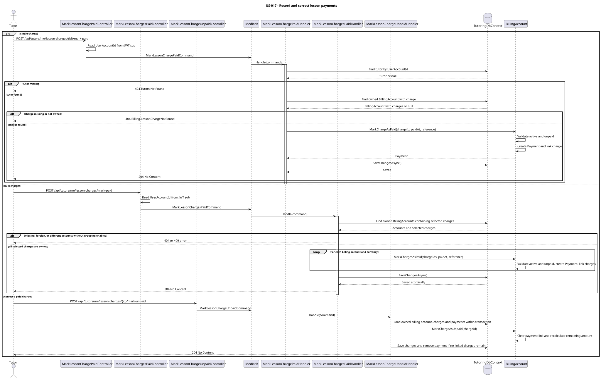

# [US-017] Mark lesson charges as paid

> As a tutor, I want to mark lesson charges as paid so that I can keep student payment records up to date.

## Scope

An authenticated tutor can mark one or several existing lesson charges as paid and correct a previously recorded payment by marking a charge as unpaid. The server reads the amounts from the selected `LessonCharge` records.

The billing account and lesson charges must already exist from the completed-lesson billing flow. This story does not create billing accounts, create lesson charges, support advance payments, or introduce payment allocation.

## FILES

- Single-charge API feature: [MarkLessonChargePaid](../../../../../TutoringManagementSystem/Tutoring.Api/Features/Tutors/MarkLessonChargePaid/)
- Bulk API feature: [MarkLessonChargesPaid](../../../../../TutoringManagementSystem/Tutoring.Api/Features/Tutors/MarkLessonChargesPaid/)
- Payment correction: [MarkLessonChargeUnpaid](../../../../../TutoringManagementSystem/Tutoring.Api/Features/Tutors/MarkLessonChargeUnpaid/)
- Billing aggregate: [BillingAccount.cs](../../../../../TutoringManagementSystem/Tutoring.Domain/Billing/BillingAccount.cs)
- Lesson charge: [LessonCharge.cs](../../../../../TutoringManagementSystem/Tutoring.Domain/Billing/LessonCharge.cs)
- Payment entity: [Payment.cs](../../../../../TutoringManagementSystem/Tutoring.Domain/Billing/Payment.cs)
- Charge persistence mapping: [LessonChargeConfiguration.cs](../../../../../TutoringManagementSystem/Tutoring.Infrastructure/Persistence/Configurations/LessonChargeConfiguration.cs)
- Persistence migration: [20261004105243_MarkLessonChargesPaid.cs](../../../../../TutoringManagementSystem/Tutoring.Infrastructure/Persistence/Migrations/20261004105243_MarkLessonChargesPaid.cs)
- Domain tests: [BillingAccountTest.cs](../../../../../TutoringManagementSystem/Tutoring.UnitTest/Billing/BillingAccountTest.cs)
- Integration tests: [MarkLessonChargesPaidTests.cs](../../../../../TutoringManagementSystem/Tutoring.IntegrationTests/Features/Tutors/MarkLessonChargesPaid/MarkLessonChargesPaidTests.cs)

## API

| Method | Endpoint | Auth | Result |
| --- | --- | --- | --- |
| GET | `/api/tutors/me/lesson-charges` | JWT, `Tutor` role | `200 OK` with active charges owned by the tutor. Optional `agreementId` and `lessonId` narrow the result. |
| POST | `/api/tutors/me/lesson-charges/{lessonChargeId}/mark-paid` | JWT, `Tutor` role | `204 No Content` |
| POST | `/api/tutors/me/lesson-charges/mark-paid` | JWT, `Tutor` role | `204 No Content` |
| POST | `/api/tutors/me/lesson-charges/{lessonChargeId}/mark-unpaid` | JWT, `Tutor` role | `204 No Content` with no request body. |

Each listed charge includes its IDs, student name, subject, lesson times, amount, currency and optional `paidAtUtc`. A null payment timestamp identifies an unpaid charge.

### Single charge request

```json
{
  "paidAtUtc": "2026-10-04T11:00:00+00:00",
  "reference": "TRANSFER-001"
}
```

### Bulk charge request

```json
{
  "lessonChargeIds": [
    "00000000-0000-0000-0000-000000000001",
    "00000000-0000-0000-0000-000000000002"
  ],
  "paidAtUtc": "2026-10-04T11:00:00+00:00",
  "reference": "TRANSFER-001"
}
```

`reference` and `paidAtUtc` are optional. When `paidAtUtc` is omitted, the server uses the current time. The single payment uses the charge amount. The bulk payment uses the sum of the selected charges.

## Business rules

- Only an authenticated tutor can mark charges as paid.
- A charge must belong to a billing account owned by the authenticated tutor.
- The billing account and all selected charges must already exist.
- A charge must have `ChargeStatus.Active` and must not already be paid.
- Payment state is separate from the existing charge lifecycle state.
- Paid charges store `IsPaid = true` and the supplied `PaidAtUtc`.
- A single operation creates one `Payment` using exactly `LessonCharge.Amount`.
- By default, a bulk operation records one payment for an agreement and a single currency. With optional `groupByAgreementAndCurrency: true`, it creates one payment per agreement and currency in the same database save.
- Bulk charge IDs must be non-empty and unique.
- A rejected bulk operation persists no changes.
- Marking an active charge as unpaid clears its payment link. If the payment covers other charges, it retains their total. When its last charge is marked unpaid, the payment is removed. Repeating the correction on an already unpaid charge succeeds.
- No payment allocation entity is created by this story.

## Implementation

- The controllers require the `Tutor` role and read `UserAccountId` from the JWT `sub` claim.
- The single handler loads a billing account with the requested charge and verifies ownership through the tutoring agreement's `TutorId`.
- The bulk handler verifies ownership of every requested charge before saving. An opt-in batch may span multiple billing accounts.
- `BillingAccount.MarkChargeAsPaid(...)` and `BillingAccount.MarkChargesAsPaid(...)` contain the main business operation.
- The aggregate validates the charge state, manages the association to `Payment`, and adjusts the payment total on correction.
- Bulk payment amount is calculated from the selected charges inside the aggregate; the request cannot override it.
- Each handler calls `SaveChangesAsync` once after the domain operation. EF Core persists the charge state and payment together.
- The development seed uses the aggregate operation to mark its seeded charge as paid.

## Error behavior

- `401 Unauthorized` — missing or invalid authentication.
- `403 Forbidden` — authenticated user does not have the `Tutor` role.
- `404 Not Found` with `Billing.LessonChargeNotFound` — charge does not exist or is not owned by the tutor.
- `409 Conflict` with `Billing.LessonChargesFromDifferentBillingAccounts` — bulk selection spans multiple billing accounts without grouping enabled.
- `409 Conflict` with `Billing.PaymentChanged` — a concurrent update requires refreshing the list before retrying.
- `400 Bad Request` — empty or duplicate bulk IDs, invalid reference, or malformed request data.
- `422 Unprocessable Entity` with `Billing.ChargeCannotBePaid` — charge is inactive or already paid.
- `422 Unprocessable Entity` with `Billing.ChargeCannotBeMarkedUnpaid` — charge is inactive.

## Diagram



PlantUML source: [mark_lesson_charges_paid.puml](diagrams/mark_lesson_charges_paid.puml)

## Tests

### Unit tests

[BillingAccountTest.cs](../../../../../TutoringManagementSystem/Tutoring.UnitTest/Billing/BillingAccountTest.cs) covers:

- initial unpaid charge state,
- single-charge payment creation using the exact charge amount,
- `IsPaid` and `PaidAtUtc` updates,
- bulk payment creation with one payment for the total,
- marking all selected charges as paid,
- rejection of an already-paid charge,
- rejection of a missing charge,
- rejection of empty and duplicate charge IDs,
- rejection of mixed currencies,
- preservation of other charges and payments when bulk validation fails,
- recalculation of a shared payment and removal after its final charge is marked unpaid.

### Integration tests

[MarkLessonChargesPaidTests.cs](../../../../../TutoringManagementSystem/Tutoring.IntegrationTests/Features/Tutors/MarkLessonChargesPaid/MarkLessonChargesPaidTests.cs) covers:

- single-charge `204` response and persisted payment/charge state,
- bulk `204` response and one payment for the summed amount,
- rejection of charges from different billing accounts without changing charge state,
- rejection of an already-paid charge without creating a second payment,
- grouping charges across accounts, rejecting a selection containing someone else's charge, and correcting a shared payment one charge at a time,
- tutor ownership protection,
- unauthenticated access.

The integration tests use the Testcontainers SQL Server fixture.


