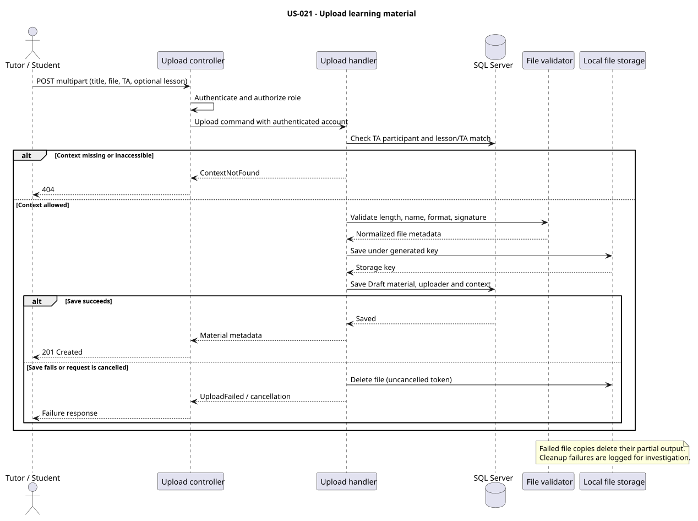

# US-021

> As a tutor or student participating in a tutoring agreement, I want to upload learning materials in an allowed file format to that agreement or one of its lessons so that I can add materials in the correct context.

## Scope

Implemented in the backend. Both tutor and student participants can upload a material to their tutoring agreement (TA), optionally attaching it to a lesson in that same TA. Role authorization is followed by a participant check using the authenticated account ID.

Each material records its TA, optional lesson, authenticated uploader, title, file metadata, UTC creation time and initial `Draft` status. Upload does not create a `MaterialAssignment`. Download, listing, publishing and attaching an existing material are outside this endpoint's scope.

## FILES

- [API slice](../../../../../TutoringManagementSystem/Tutoring.Api/Features/LearningMaterials/UploadLearningMaterial/)
- [API exceptions](../../../../../TutoringManagementSystem/Tutoring.Api/Features/LearningMaterials/Exceptions/)
- [Domain](../../../../../TutoringManagementSystem/Tutoring.Domain/LearningMaterials/LearningMaterial.cs)
- [File validation and storage](../../../../../TutoringManagementSystem/Tutoring.Infrastructure/FileStorage/)
- [Unit tests](../../../../../TutoringManagementSystem/Tutoring.UnitTest/LearningMaterials/)
- [Integration tests](../../../../../TutoringManagementSystem/Tutoring.IntegrationTests/Features/LearningMaterials/UploadLearningMaterial/)

## API

`POST /api/learning-materials` accepts `multipart/form-data` and requires a `Tutor` or `Student` role.

| Field | Required | Meaning |
| --- | --- | --- |
| `title` | Yes | Trimmed title, 1–200 characters |
| `file` | Yes | One nonempty file |
| `tutoringAgreementId` | Yes | Agreement in which the caller participates |
| `lessonId` | No | Lesson belonging to the supplied agreement |

Success returns `201 Created`:

```json
{
  "materialId": "...",
  "tutoringAgreementId": "...",
  "lessonId": null,
  "uploadedByUserAccountId": "...",
  "title": "Notes",
  "fileName": "notes.pdf",
  "contentType": "application/pdf",
  "sizeBytes": 1024,
  "status": "Draft",
  "createdAtUtc": "2026-10-29T12:00:00+00:00"
}
```

The response does not expose the storage key or physical path.

| HTTP | Code / condition |
| --- | --- |
| 400 | Missing/malformed form fields; `LearningMaterials.EmptyFile`, `InvalidFile`, `InvalidFileName`, `UnsupportedFormat` or `InvalidFileContent` (all prefixed with `LearningMaterials.`) |
| 401 | Missing authentication or invalid/missing account identity |
| 403 | Neither supported role is present |
| 404 | `LearningMaterials.ContextNotFound`: detail identifies an unavailable TA or a missing lesson in the specified TA |
| 413 | `LearningMaterials.FileTooLarge`: file exceeds the configured limit |
| 422 | `LearningMaterials.InvalidMetadata`: invalid domain metadata |
| 500 | `LearningMaterials.UploadFailed`: material persistence failed after saving the file |

The endpoint applies an overall request limit of the configured file size plus 64 KiB for multipart overhead. Requests rejected during multipart parsing or by a reverse proxy may have a different validation response from the file validator.

`UploadRequestLimitsFilter` runs before model binding. It sets the server request-body limit through `IHttpMaxRequestBodySizeFeature` when supported and still writable, and configures the form reader's `MultipartBodyLengthLimit` for each multipart section. The extra 64 KiB is a transport allowance for form fields, boundaries and headers; the file validator still enforces the exact configured file size. A missing or read-only server feature leaves the host's existing request limit in effect. Upstream proxy/IIS limits must be configured separately.

## Implementation

`MaterialUpload` in `appsettings.json` configures `AllowedExtensions` (initially `.pdf`, `.jpg`, `.png`) and `MaxSizeBytes` (initially 20,000,000 bytes, or 20 MB). The allowlist can enable/disable supported formats; adding a new format also requires implementing its signature and MIME mapping.

`IUploadedFileValidator` is replaceable, with `UploadedFileValidator` in Infrastructure. It checks the actual buffered length, limit, sanitized name, extension and initial file signature, then rewinds the stream. MIME is derived from the detected format rather than trusted from client headers. Signature checking does not fully parse documents/images or scan for malware.

`LocalFileStorage` generates storage keys, rejects path traversal and deletes partial files after failed/cancelled copies. If metadata persistence fails, the handler attempts deletion with an uncancelled token. Cleanup failures are logged; the persistence exception is preserved as the inner exception of `MaterialUploadFailedException`. Request cancellation is rethrown after cleanup. A process crash or failed cleanup can still leave an orphaned file; filesystem and SQL writes are not one transaction.

The `AddLearningMaterialUploadContext` migration replaces the tutor-only relationship with uploader, required TA and optional lesson foreign keys. It refuses migration or rollback when `LearningMaterials` is nonempty, rather than guessing legacy relationships or deleting data. Existing rows require an explicit data migration first. No development/shared database migration is performed as part of implementation. Legacy `MaterialAssignments` remains in persistence but is unused by this upload.



[PlantUML source](diagrams/upload_learning_material.puml)

## Tests

Source coverage includes Domain invariants, configured file policy, PDF/JPG/PNG signatures, size boundaries, storage traversal and cleanup, tutor/student uploads with and without a lesson, persisted uploader/context/file data, unrelated accounts, missing resources/fields, mismatched TA/lesson, authentication/role failures, metadata persistence failure and cancellation compensation.

Run from `TutoringManagementSystem`:

```text
dotnet test Tutoring.UnitTest/Tutoring.UnitTest.csproj --no-build
dotnet test Tutoring.IntegrationTests/Tutoring.IntegrationTests.csproj --no-build --filter FullyQualifiedName~UploadLearningMaterial
```

Integration tests use the shared isolated SQL Server Testcontainer and a temporary storage directory, reset between tests.
