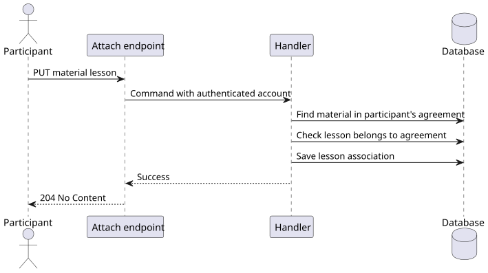

# US-022

> As a tutor or student participating in a tutoring agreement, I want to attach a learning material to a lesson in that agreement so that the material is connected to the right session.

## Scope

Implemented: attach an existing material to a lesson in its tutoring agreement. A participant can replace its existing lesson association; attaching the same lesson again succeeds. Each material has at most one lesson. Detaching is outside this endpoint's scope. [US-021](../us_021/README.md) also supports choosing a lesson when uploading a new material.

## Files

- [API slice](../../../../../TutoringManagementSystem/Tutoring.Api/Features/LearningMaterials/AttachLearningMaterialToLesson/)
- [Domain](../../../../../TutoringManagementSystem/Tutoring.Domain/LearningMaterials/LearningMaterial.cs)
- [Unit tests](../../../../../TutoringManagementSystem/Tutoring.UnitTest/LearningMaterials/LearningMaterialTests.cs)
- [Integration tests](../../../../../TutoringManagementSystem/Tutoring.IntegrationTests/Features/LearningMaterials/AttachLearningMaterialToLesson/)

## API and rules

`PUT /api/learning-materials/{materialId}/lesson` requires an authenticated `Tutor` or `Student` participating in the material's tutoring agreement.

```json
{ "lessonId": "00000000-0000-0000-0000-000000000001" }
```

The lesson must exist in the same agreement as the material. The handler updates the existing material without changing the file. Success returns `204 No Content`.

| HTTP | Condition |
| --- | --- |
| 400 | Missing, null or malformed `lessonId` |
| 401 | Missing authentication or invalid/missing account identity |
| 403 | Caller lacks a supported role |
| 404 | `LearningMaterials.ContextNotFound`: material unavailable to the caller, or lesson missing from the material's agreement |
| 422 | `LearningMaterials.InvalidMetadata`: empty lesson ID |

## Flow



[PlantUML source](diagrams/attach_learning_material.puml)

## Tests

Unit tests cover attach, repeat, replacement and empty identifiers. Integration tests cover both participant roles, persisted changes, inaccessible or missing material, missing or cross-agreement lesson, invalid input, authentication and role failures, and unchanged state after rejection.

Run from `TutoringManagementSystem`:

```text
dotnet test Tutoring.UnitTest/Tutoring.UnitTest.csproj --no-build
dotnet test Tutoring.IntegrationTests/Tutoring.IntegrationTests.csproj --no-build --filter FullyQualifiedName~AttachLearningMaterialToLesson
```
