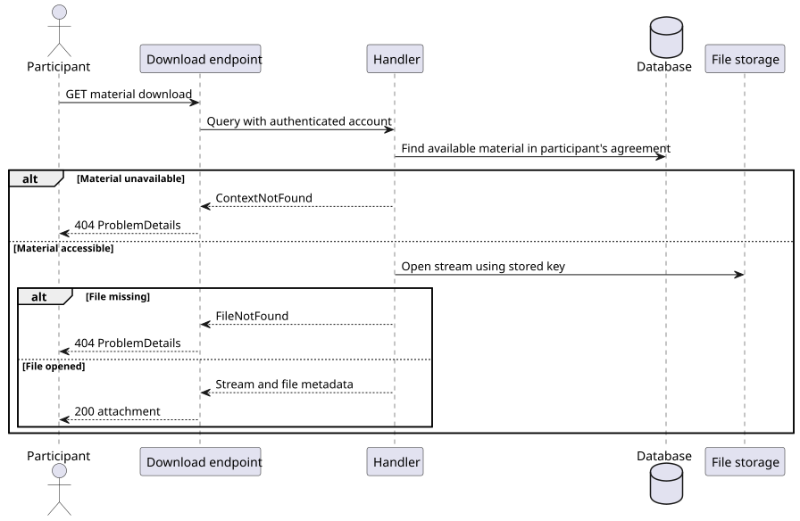

# US-024

> As an authorized user, I want to download shared files so that I can use learning materials outside the system.

## Scope

Implemented in the backend. A tutor or student can download a material uploaded by either participant in their tutoring agreement. Upload makes a material available to both participants in its initial `Draft` status. `Published` materials are also downloadable. `Archived` and `Deleted` materials are unavailable. An optional lesson link does not change access.

See [US-021](../us_021/README.md) for uploading and [US-022](../us_022/README.md) for lesson attachment.

## API

`GET /api/learning-materials/{materialId}/download` accepts a GUID and requires the `Tutor` or `Student` role. The handler checks agreement membership using the authenticated account ID before opening the file.

| HTTP | Behavior |
| --- | --- |
| 200 | Streams the file with its stored media type, the original sanitized filename in `Content-Disposition: attachment`, and `Cache-Control: no-store`. |
| 401 | Missing authentication or invalid account identity. |
| 403 | Caller lacks a supported role. |
| 404 | `LearningMaterials.ContextNotFound` for a missing material, an unavailable status, or a material outside the caller's agreements. |
| 404 | `LearningMaterials.FileNotFound` when an accessible material has no file in storage. |
| 500 | `LearningMaterials.DownloadFailed` for other file-open errors. The response omits internal storage details. |

The handler uses the existing storage abstraction and persisted file metadata. Downloads require no database writes or schema changes.

## Flow



[PlantUML source](diagrams/download_learning_material.puml)

## Files and tests

- [API slice](../../../../../TutoringManagementSystem/Tutoring.Api/Features/LearningMaterials/DownloadLearningMaterial/)
- [Integration tests](../../../../../TutoringManagementSystem/Tutoring.IntegrationTests/Features/LearningMaterials/DownloadLearningMaterial/)

Integration coverage includes downloads by both participant roles, lesson and agreement materials, file bytes and headers, status visibility, inaccessible and missing materials, a missing file, and authentication and role checks. Run from `TutoringManagementSystem` with the isolated SQL Server Testcontainer available.

```text
dotnet test Tutoring.IntegrationTests/Tutoring.IntegrationTests.csproj --filter FullyQualifiedName~DownloadLearningMaterial
```
