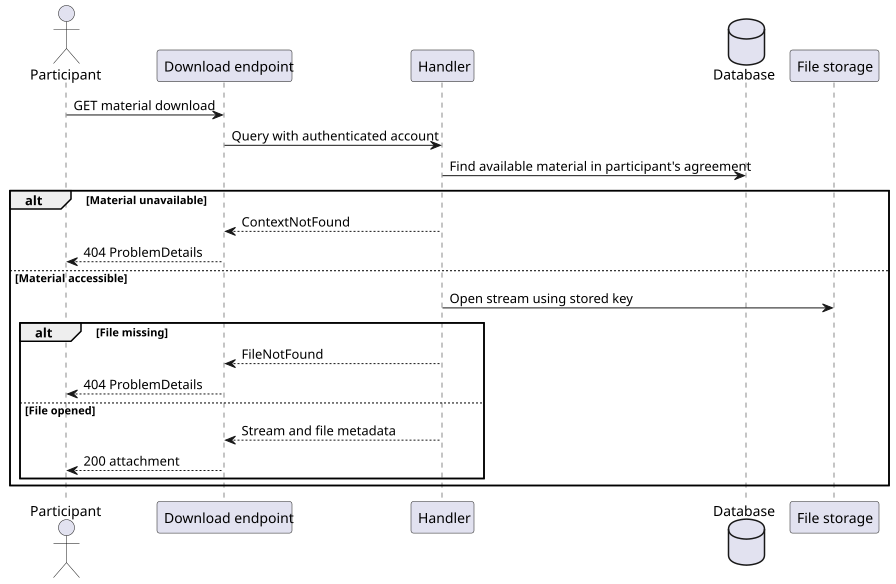

# US-026

> As a user, I want files to be available only to authorized people so that learning materials and student data stay protected.

## Scope

Implemented in the backend through [US-024](../us_024/README.md). Access to a file follows its tutoring agreement. An optional lesson association does not change who can download it.

## Authorization

`GET /api/learning-materials/{materialId}/download` requires an authenticated account with the `Tutor` or `Student` role. Before opening the file, the handler checks that the account belongs to the tutor or student on the material's agreement and that the material is in `Draft` or `Published` status.

- `401 Unauthorized` for missing authentication or invalid account identity.
- `403 Forbidden` when the account lacks a supported role.
- `404 Not Found` with `LearningMaterials.ContextNotFound` for missing, unavailable, or inaccessible materials. The same response prevents callers from distinguishing another agreement's material from a missing one.

Upload and lesson attachment also require agreement membership. Deletion applies separate ownership rules. See [US-021](../us_021/README.md), [US-022](../us_022/README.md), and [US-025](../us_025/README.md).

## Files and tests

- [Download authorization and file streaming](../../../../../TutoringManagementSystem/Tutoring.Api/Features/LearningMaterials/DownloadLearningMaterial/)
- [Agreement membership queries](../../../../../TutoringManagementSystem/Tutoring.Api/Features/Common/Authorization/AgreementAccessQueries.cs)
- [Download integration tests](../../../../../TutoringManagementSystem/Tutoring.IntegrationTests/Features/LearningMaterials/DownloadLearningMaterial/DownloadLearningMaterialTests.cs) cover both participant roles, outsiders, unauthenticated callers, unsupported roles, and unavailable materials.

## Sequence diagram

