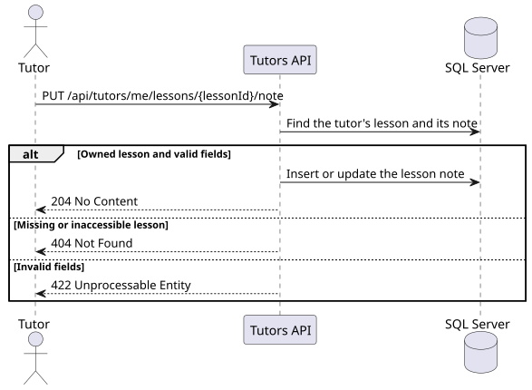

# US-027

> As a tutor, I want to record lesson topics, covered issues, and student progress so that I can document the learning process.

## API

`PUT /api/tutors/me/lessons/{lessonId}/note` creates or replaces the single note for a lesson.
Only the tutor who owns the lesson's agreement can save the note. The operation is available
regardless of lesson status.

The JSON body contains three required strings. The API trims surrounding whitespace before
applying these limits.

- `topic` accepts 1–200 characters.
- `coveredTopics` accepts 1–2,000 characters.
- `studentProgress` accepts 1–2,000 characters.

The endpoint returns `204 No Content` on success, `401` without authentication,
`403` without the tutor role, `404` with `Lessons.LessonNotFound` for an inaccessible or missing
lesson, and `422` with `Lessons.InvalidNote` for invalid fields.

## Files

- [API slice](../../../../../TutoringManagementSystem/Tutoring.Api/Features/Tutors/SaveLessonNote)
- [Integration tests](../../../../../TutoringManagementSystem/Tutoring.IntegrationTests/Features/Tutors/SaveLessonNote/SaveLessonNoteTests.cs)

## Sequence diagram

