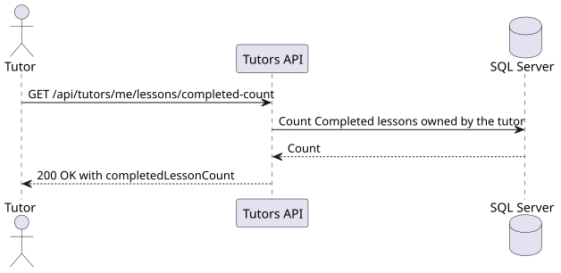

# US-028

> As a tutor, I want to see the number of completed lessons so that I can track my activity.

## API

`GET /api/tutors/me/lessons/completed-count` returns `200 OK` with
`{ "completedLessonCount": 0 }` when the tutor has no completed lessons.
The count includes all lessons marked `Completed` across the authenticated tutor's
agreements, including ended agreements. Scheduled, cancelled, and missed lessons are excluded.

The endpoint returns `401` without authentication and `403` without the tutor role.

## Files

- [API slice](../../../../../TutoringManagementSystem/Tutoring.Api/Features/Tutors/GetCompletedLessonCount)
- [Integration tests](../../../../../TutoringManagementSystem/Tutoring.IntegrationTests/Features/Tutors/GetCompletedLessonCount/GetCompletedLessonCountTests.cs)

## Sequence diagram

