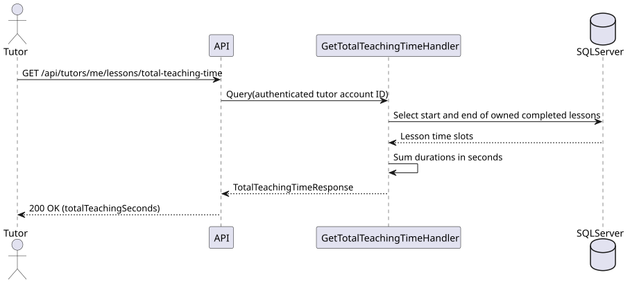

# US-029

> As a tutor, I want to see the total time spent teaching so that I can analyze my workload.

Backend and integration coverage implemented for #119 and #121. The tutor statistics UI is tracked separately in #120.

## API

`GET /api/tutors/me/lessons/total-teaching-time` returns `200 OK` with
`{ "totalTeachingSeconds": 6300.125 }`. The total is the sum of each completed
lesson's scheduled end minus its scheduled start, expressed in seconds with
fractional seconds preserved. The endpoint includes the authenticated tutor's
completed lessons across all agreements, including ended agreements. Scheduled,
missed, and cancelled lessons are excluded. An empty result returns
`{ "totalTeachingSeconds": 0 }`.

The endpoint uses the tutor's account identity from the token. It returns
`401` without valid authentication or account identity and `403` without the tutor role.

## Files

- [API slice](../../../../../TutoringManagementSystem/Tutoring.Api/Features/Tutors/GetTotalTeachingTime)
- [Integration tests](../../../../../TutoringManagementSystem/Tutoring.IntegrationTests/Features/Tutors/GetTotalTeachingTime/GetTotalTeachingTimeTests.cs) cover durations, status and ownership filtering, empty results, and access control.

## Sequence diagram

