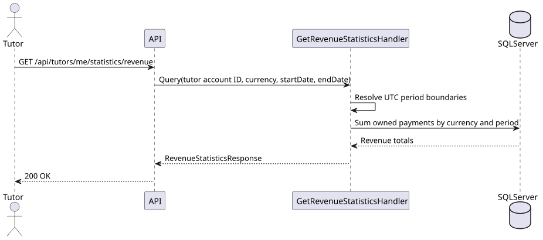

# US-030

> As a tutor, I want to see weekly, monthly, and yearly revenue so that I can monitor my financial results.

Backend and integration coverage implemented for #122 and #124. The tutor statistics UI is tracked in #123.

## API

`GET /api/tutors/me/statistics/revenue` returns `200 OK` for the authenticated tutor.

```json
{
  "revenueByCurrency": [
    { "currency": "PLN", "weekly": 100.25, "monthly": 300.50, "yearly": 1200.75 }
  ]
}
```

Revenue is the sum of recorded payments across the tutor's agreements, based on
`PaidAtUtc`. Each total starts at midnight UTC on the first day of the current
period and includes payments through the current instant. The week starts on
Monday and can include days from the preceding month or year.

Optional query parameters:

- `currency` filters by a three-letter currency code, case-insensitively.
- `startDate` (`YYYY-MM-DD`) excludes payments before midnight UTC on that date.
- `endDate` (`YYYY-MM-DD`) selects the UTC day used to determine the week,
  month, and year. A past date includes the entire selected day. If omitted or
  set to today, the upper limit is the current instant.

Each total covers the intersection of its calendar period and the selected date
range. For example, `?currency=PLN&startDate=2025-12-15&endDate=2025-12-31`
shows PLN totals through December 31 with no payments from before December 15.
Malformed filters, an end date in the future, and a start date after the
effective end date return `400 Bad Request`.

The response keeps currencies separate. A currency with payments in at least one
period appears with zero for periods without payments. If none of the periods
has payments, the response is `{ "revenueByCurrency": [] }`.

The endpoint reads the tutor's account identity from the JWT. It returns `401`
without valid authentication or account identity and `403` without the tutor role.

## Files

- [API slice](../../../../../TutoringManagementSystem/Tutoring.Api/Features/Tutors/GetRevenueStatistics)
- [Integration tests](../../../../../TutoringManagementSystem/Tutoring.IntegrationTests/Features/Tutors/GetRevenueStatistics/GetRevenueStatisticsTests.cs) cover period boundaries, currency separation, ownership, empty results, access control, and optional filters.

## Sequence diagram


