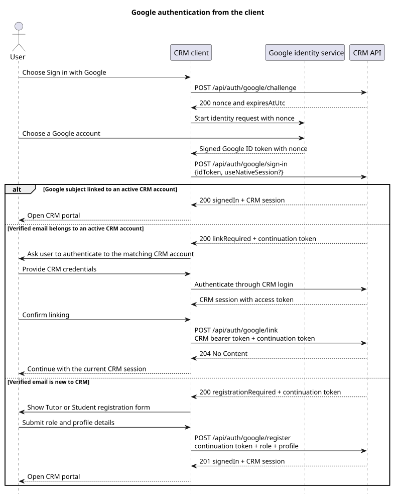
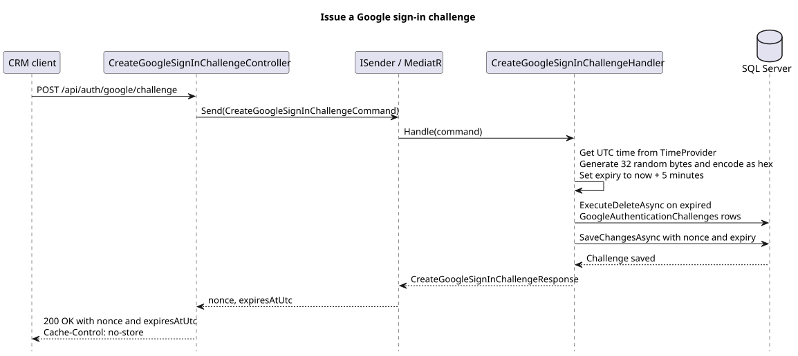
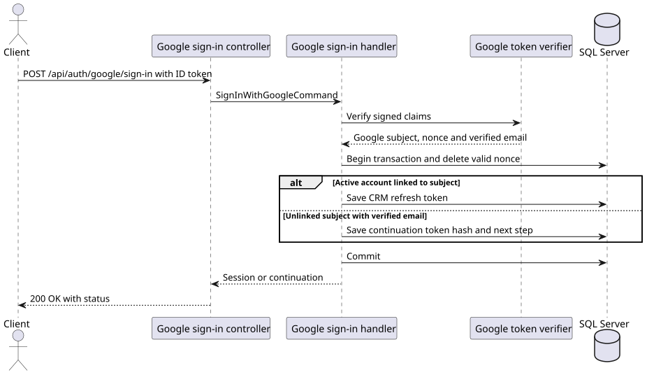
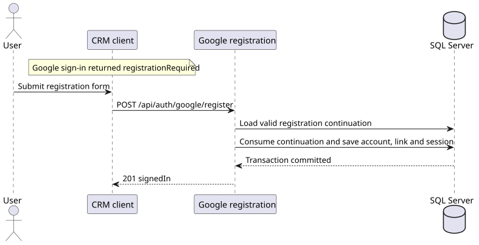

# US-073 — Sign in with Google

## Scope

The client obtains a Google ID token and exchanges it for a CRM session or a short-lived continuation. An active account linked to the Google subject can sign in. An existing CRM account with a matching email can be linked after the user authenticates to that account. A new user can register as a Tutor or Student using the email verified by Google. This document describes the implemented backend and the client calls it expects. The Expo sign-in screen acquires a Google ID token using a fresh backend nonce and exchanges it for a CRM session. Successful sign-in reuses shared session storage, refresh, and role-based routing. The frontend completes account linking after CRM password sign-in and explicit confirmation. New users complete Google registration by choosing a role and username, then enter the portal with the issued CRM session. [GitHub issue #167](https://github.com/JStec0312/Tutoring-CRM-System/issues/167)

## Frontend session exchange

[SignInForm](../../../../../mobile/src/features/auth/sign-in/components/SignInForm.tsx)
exchanges the Google ID token through [sign-in-with-google](../../../../../mobile/src/features/auth/sign-in/api/sign-in-with-google.ts).
The response parser validates the status and required session or continuation fields.
Native requests send `useNativeSession: true`; browser requests retain the existing
refresh-cookie transport. Successful responses enter the shared session manager,
which serializes credential changes, finishes pending sign-out, stores native refresh
credentials, synchronizes browser tabs, and updates roles for portal routing.
Password sign-in uses the same session acceptance path.

The Google ID token stays in a local variable only while the exchange is running.
It is not retained in a ref, UI, or browser storage. Cancellation does not call the
exchange endpoint. Invalid credentials, inactive accounts, unavailable verification,
network failures, and rate limiting produce English messages and allow retrying.
`linkRequired` opens `/link-google`, while `registrationRequired` opens
`/register-google`. Both use the in-memory
[GoogleContinuationProvider](../../../../../mobile/src/features/auth/sign-in/models/GoogleContinuationProvider.tsx).
The status distinguishes the continuation purpose. Tokens never go in route params
or browser storage and are removed on expiry, cancellation, or completion.
Refreshing the page requires starting Google sign-in again.

Frontend tests cover both session transports, continuation results, malformed and
expired responses, API errors, and sign-out during token exchange. Google SDK tests
use mocks; they do not establish that live Google consent or native builds work.

### Frontend account linking and registration

[GoogleLinkScreen](../../../../../mobile/src/features/auth/google-link/components/GoogleLinkScreen.tsx)
reuses the shared password form to authenticate to the matching CRM account. It
remains available after authentication and requires explicit **Connect Google
account** confirmation before sending `/api/auth/google/link` with the current CRM
bearer token. Success clears the continuation and opens the existing session's
portal. Cancelling after password sign-in keeps the CRM session; cancelling before
sign-in returns to the sign-in page. There is no account-switch action on this screen.

[GoogleRegistrationScreen](../../../../../mobile/src/features/auth/google-register/components/GoogleRegistrationScreen.tsx)
contains a separate registration form requiring a Student/Tutor role and username.
It does not collect email or password: the backend reads the Google-verified email
from the continuation. Optional profile fields are omitted at this stage.
[registerWithGoogle](../../../../../mobile/src/features/auth/google-register/api/register-with-google.ts)
sends the continuation and form data to `/api/auth/google/register` anonymously,
with `useNativeSession: true` on native platforms. The returned `signedIn` response
is validated and accepted through the shared session manager, including native
refresh-token storage and browser refresh cookies, then the role portal opens.

The role picker is shared with password registration. Pending operations block
duplicate submissions and cancellation. Expired, missing, or wrong-purpose
continuations cannot submit. Username conflicts and network/API errors display
English messages and permit retrying while the continuation remains valid.

[Frontend interaction tests](../../../../../mobile/tests/features/auth/sign-in/google-continuation-flow.test.tsx)
cover routing, consent, linking, registration, role selection, validation, retries,
expiry, cancellation, and duplicate submissions with controlled HTTP responses.
[Registration API tests](../../../../../mobile/tests/features/auth/google-register/register-with-google.test.ts)
cover role mapping, both session transports, response validation, and backend errors.
These tests use Google SDK mocks and do not establish live Google/database behavior.

## Sequence diagrams

### End-to-end client flow

The Google ID token returns to the client. Each continuation response ends the current HTTP request. The client prompts the user and sends the next request after confirmation or form submission.

[PlantUML source](diagrams/google-auth-flow.puml)

### Issue the challenge

[PlantUML source](diagrams/create-google-sign-in-challenge.puml) · [Controller](../../../../../TutoringManagementSystem/Tutoring.Api/Features/Auth/CreateGoogleSignInChallenge/CreateGoogleSignInChallengeController.cs) · [Handler](../../../../../TutoringManagementSystem/Tutoring.Api/Features/Auth/CreateGoogleSignInChallenge/CreateGoogleSignInChallengeHandler.cs)

### Verify the Google credential and choose the next step

[PlantUML source](diagrams/sign-in-with-google.puml) · [Controller](../../../../../TutoringManagementSystem/Tutoring.Api/Features/Auth/SignInWithGoogle/SignInWithGoogleController.cs) · [Handler](../../../../../TutoringManagementSystem/Tutoring.Api/Features/Auth/SignInWithGoogle/SignInWithGoogleHandler.cs) · [Google token verifier](../../../../../TutoringManagementSystem/Tutoring.Infrastructure/Authentication/Google/GoogleSignInTokenVerifier.cs)

### Link an existing CRM account

[PlantUML source](diagrams/complete-google-account-link.puml) · [Controller](../../../../../TutoringManagementSystem/Tutoring.Api/Features/Auth/CompleteGoogleAccountLink/CompleteGoogleAccountLinkController.cs) · [Handler](../../../../../TutoringManagementSystem/Tutoring.Api/Features/Auth/CompleteGoogleAccountLink/CompleteGoogleAccountLinkHandler.cs)

### Register a new CRM account

[PlantUML source](diagrams/register-with-google.puml) · [Controller](../../../../../TutoringManagementSystem/Tutoring.Api/Features/Auth/RegisterWithGoogle/RegisterWithGoogleController.cs) · [Handler](../../../../../TutoringManagementSystem/Tutoring.Api/Features/Auth/RegisterWithGoogle/RegisterWithGoogleHandler.cs)

## FILES

| Concern | Implementation |
| --- | --- |
| Google authentication | [Challenge](../../../../../TutoringManagementSystem/Tutoring.Api/Features/Auth/CreateGoogleSignInChallenge/), [sign-in](../../../../../TutoringManagementSystem/Tutoring.Api/Features/Auth/SignInWithGoogle/), [account linking](../../../../../TutoringManagementSystem/Tutoring.Api/Features/Auth/CompleteGoogleAccountLink/), [registration](../../../../../TutoringManagementSystem/Tutoring.Api/Features/Auth/RegisterWithGoogle/) |
| Google identity and persistence models | [Infrastructure authentication](../../../../../TutoringManagementSystem/Tutoring.Infrastructure/Authentication/Google/), [challenge mapping](../../../../../TutoringManagementSystem/Tutoring.Infrastructure/Persistence/Configurations/GoogleAuthenticationChallengeConfiguration.cs), [link mapping](../../../../../TutoringManagementSystem/Tutoring.Infrastructure/Persistence/Configurations/GoogleSignInAccountLinkConfiguration.cs), [continuation mapping](../../../../../TutoringManagementSystem/Tutoring.Infrastructure/Persistence/Configurations/GoogleSignInContinuationConfiguration.cs) |
| Shared CRM session | [LoginSessionIssuer](../../../../../TutoringManagementSystem/Tutoring.Api/Features/Auth/Login/LoginSessionIssuer.cs), [LoginRefreshTokenCookie](../../../../../TutoringManagementSystem/Tutoring.Api/Features/Auth/Login/LoginRefreshTokenCookie.cs), [SignInWithGoogleResponse](../../../../../TutoringManagementSystem/Tutoring.Api/Features/Auth/SignInWithGoogle/SignInWithGoogleResponse.cs), [US-002](../us_002/README.md) |

## API

All four endpoints use POST. JSON field names below match the HTTP contract.

### `/api/auth/google/challenge`

Anonymous. Send an empty body or `{}`. The `200 OK` response contains `nonce` (64 hexadecimal characters) and `expiresAtUtc` (ISO 8601 UTC). Pass the nonce to Google when starting the identity request. The response uses `Cache-Control: no-store`. Malformed JSON returns `400`.

### `/api/auth/google/sign-in`

Anonymous. Send `{"idToken":"<Google ID token>"}` as application/json. The token has an 8,192-character limit and the request has a 16,384-byte limit. Native clients can include `"useNativeSession":true`. The endpoint returns `200 OK` for each of these outcomes, with `Cache-Control: no-store`.

| `status` | Response | Next client action |
| --- | --- | --- |
| `signedIn` | `accessToken` and `expiresAt`, with refresh credentials delivered using the selected transport | Store the CRM session and open the portal for the account's role. |
| `linkRequired` | `continuationToken` and `continuationExpiresAtUtc` | Authenticate to the matching CRM account, prompt for confirmation, and submit the link request. |
| `registrationRequired` | `continuationToken` and `continuationExpiresAtUtc` | Collect the user's role and profile details, then submit registration. |

### `/api/auth/google/link`

Requires a CRM bearer access token. Send `{"continuationToken":"<token from linkRequired>"}`. The controller reads the CRM account ID from the authenticated JWT `sub`. The body carries a 64-character continuation token. The endpoint returns `204 No Content`. The session used to confirm the link stays usable. A subsequent Google sign-in can issue a session for the same account.

### `/api/auth/google/register`

Anonymous. Send a 64-character `continuationToken` from `registrationRequired`, `role` set to `Tutor` or `Student`, and `userName` of at most 100 characters. Optional fields are `firstName` and `lastName` (100 characters each), `phoneNumber` (30 characters), and `useNativeSession` (defaults to false). The server reads email and Google subject from the continuation. A successful response is `201 Created` with `status: "signedIn"`, the CRM session, and `Cache-Control: no-store`.

### Error responses

| Endpoint | HTTP status | Condition or ProblemDetails code |
| --- | --- | --- |
| Sign-in | `400` | Missing or invalid JSON fields |
| Sign-in | `401` | `Auth.InvalidGoogleSignIn` for an invalid Google ID token or an unusable nonce. `Auth.GoogleVerifiedEmailRequired` for an unlinked identity without a valid verified email. |
| Sign-in | `403` | `Auth.InactiveAccount.` when the linked or email-matched CRM account is inactive |
| Sign-in | `503` | `Auth.GoogleSignInUnavailable` when the Google client ID is missing or verification is unavailable |
| Link | `400` | Invalid JSON or continuation token length |
| Link | `401` | Missing or invalid CRM identity. `Auth.InvalidGoogleLinkContinuation` when the continuation is unknown, expired, consumed, for registration, or for another account, or when the account's email no longer matches. |
| Link | `403` | `Auth.InactiveAccount.` when the matching CRM account is inactive |
| Link | `409` | `Auth.GoogleAccountLinkConflict` when the Google subject or the CRM account already has a link |
| Register | `400` | Invalid form fields or a role outside the public registration flow |
| Register | `401` | `Auth.InvalidGoogleRegistrationContinuation` when the continuation is unknown, expired, consumed, or for linking |
| Register | `409` | `Auth.GoogleRegistrationConflict` if the email or Google subject already exists. `Username.AlreadyTaken` or `PhoneNumber.AlreadyTaken` for conflicting profile fields. |

Authentication and domain exceptions are translated by the API's [global exception handler](../../../../../TutoringManagementSystem/Tutoring.Api/GlobalExceptionHandler.cs).

## Implementation

### Challenge and Google token verification

`CreateGoogleSignInChallengeHandler` generates 32 random bytes and encodes them as hexadecimal. It uses `TimeProvider` to set a five-minute UTC expiry, deletes expired rows from `GoogleAuthenticationChallenges`, and saves the new nonce. The client sends that nonce to Google, which includes it in the signed ID token. The sign-in request carries the ID token containing the nonce claim.

`GoogleSignInTokenVerifier` validates the Google signature, issuer, expected audience, and expiry before extracting the claims. It requires a nonblank Google `sub` of at most 255 characters and a 64-character hexadecimal `nonce`. It exposes a verified email only when Google marks `email_verified` as true. The CRM uses Google `sub` to identify the external account. The `sub` in the access token issued by the CRM contains the CRM account GUID.

### Sign-in decision and transaction

After verification, `SignInWithGoogleHandler` opens a SQL transaction and deletes the challenge using the signed nonce and the condition `ExpiresAtUtc > now`. A deletion count of zero stops the flow. The handler loads the linked CRM account and its roles by Google subject. An active match goes straight to session issuance, including when the Google email has changed. An inactive match returns `403`.

With an unlinked Google subject, the handler validates the verified email using the domain email type and looks for a CRM account by email. An active match sets `RequiresLink` and stores its CRM account ID in the continuation. With no account match, it stores a null account ID and returns `registrationRequired`. An inactive email match returns `403`. Before storing a fresh continuation the handler removes expired ones. It generates a 32-byte random token, stores its SHA-256 hash with a five-minute UTC expiry, and returns the original token to the client. Consuming the nonce and saving the refresh token or continuation commit together.

### Completion rules

`CompleteGoogleAccountLinkHandler` hashes the continuation token and looks for a valid row assigned to the JWT's CRM account ID. It checks the account's current email and active status. It deletes the continuation by its hash and requires one affected row, then inserts the Google subject and CRM account ID into `GoogleSignInAccountLinks`. Both changes commit together. SQL Server's uniqueness constraints determine the winner of competing link requests.

`RegisterWithGoogleHandler` reads a valid continuation whose account ID is null and claims it by deleting the row by hash. It checks for an existing CRM email or Google link, then validates the username and optional phone number against existing profiles. It creates an active `UserAccount` with no password, assigns the selected role, and creates the corresponding Tutor or Student record. A Google-verified email is sufficient for registration regardless of domain. The account, role, profile, Google link, refresh token, and continuation deletion commit together. An active account created through Google can set its first password through the existing password-reset flow.

The link and register handlers both require one row to be deleted. That lets only one concurrent request claim the same continuation. If a later check or save fails, disposal of the transaction rolls the deletion back. Expired and successfully consumed continuations require a new Google sign-in attempt.

### Session transport

`LoginSessionIssuer` issues a CRM JWT from the account and its roles, creates a refresh token in a new family, and stages the hashed refresh token for saving. The surrounding handler saves it in the transaction. `SignInWithGoogleResponse` omits optional fields whose values are null.

| Client | Access token delivery | Refresh token delivery | Next refresh |
| --- | --- | --- | --- |
| Browser, including a mobile browser | `accessToken` and `expiresAt` in JSON | `Set-Cookie` using `LoginRefreshTokenCookie` | `POST /api/auth/refresh` with the refresh cookie |
| Native app sending `useNativeSession: true` | `accessToken` and `expiresAt` in JSON | `refreshToken` and `refreshTokenExpiresAt` in JSON for device secure storage | `POST /api/auth/mobile/refresh` with the refresh token in JSON |

The default cookie is `refresh_token` with `HttpOnly`, `Secure`, `SameSite=Strict`, and path `/api/auth/`. Development configuration disables `Secure` for local HTTP. Refresh rotation and sign-out use the same CRM APIs for password and Google sessions. [Session lifecycle in US-002](../us_002/README.md)

### Persistence

| Table | Stored data and constraints |
| --- | --- |
| `GoogleAuthenticationChallenges` | Nonce as a case-sensitive primary key and indexed UTC expiry. Issued and consumed by the challenge and sign-in handlers. |
| `GoogleSignInContinuations` | Token hash as a case-sensitive primary key, Google subject, verified email, nullable CRM account ID, and indexed UTC expiry. A nonnull account ID identifies a link attempt. |
| `GoogleSignInAccountLinks` | Case-sensitive Google subject as primary key and a unique CRM account foreign key. Each side can be linked once. |
| `UserAccounts`, `UserAccountRoles`, `Tutors`, `Students` | The CRM identity and its role. Accounts created through Google start with a null `PasswordHash`. |
| `RefreshTokens` | CRM refresh-token hash, family ID, expiry, and request metadata. |

### Configuration and migrations

Set `GoogleSignIn__ClientId` on the API to the OAuth client ID that the client's Google ID tokens use as their audience. The verifier reads `GoogleSignIn:ClientId` from configuration. Compose forwards the setting from the environment. Apply the challenge, sign-in persistence, and registration migrations in order. Registration makes `UserAccounts.PasswordHash` nullable and removes the retired `IsEmailAuthoritative` column from Google continuations. Its rollback requires setting passwords for all passwordless accounts first. [Environment example](../../../../../.env.example) · [Compose configuration](../../../../../docker-compose.yml) · [Challenge migration](../../../../../TutoringManagementSystem/Tutoring.Infrastructure/Persistence/Migrations/20261116211900_AddGoogleAuthenticationChallenges.cs) · [Sign-in migration](../../../../../TutoringManagementSystem/Tutoring.Infrastructure/Persistence/Migrations/20261116212000_AddGoogleSignInSessions.cs) · [Registration migration](../../../../../TutoringManagementSystem/Tutoring.Infrastructure/Persistence/Migrations/20261116214009_EnableGoogleAccountRegistration.cs)

## Tests

| Suite | Coverage |
| --- | --- |
| [Challenge](../../../../../TutoringManagementSystem/Tutoring.IntegrationTests/Features/Auth/CreateGoogleSignInChallenge/) | Anonymous issuance, response cache control, nonce uniqueness and expiry cleanup |
| [Sign-in](../../../../../TutoringManagementSystem/Tutoring.IntegrationTests/Features/Auth/SignInWithGoogle/) | Linked sign-in over both transports, both continuation results, concurrent nonce replay, expired nonce, invalid token, missing verified email, unavailable verifier, inactive account |
| [Linking](../../../../../TutoringManagementSystem/Tutoring.IntegrationTests/Features/Auth/CompleteGoogleAccountLink/) | Linking and subsequent Google sign-in, wrong-account access, expired and registration-only continuations, concurrent consumption, uniqueness conflicts |
| [Registration](../../../../../TutoringManagementSystem/Tutoring.IntegrationTests/Features/Auth/RegisterWithGoogle/) | Tutor and Student registration, external email domain, both session transports, passwordless account and reset, duplicate email, invalid continuations, concurrent registration, rejected administrator role |

The integration fixture uses SQL Server with migrations applied. Tests covering Google sign-in replace the Google verifier to exercise the CRM flow deterministically. [Integration fixture](../../../../../TutoringManagementSystem/Tutoring.IntegrationTests/Infrastructure/IntegrationTestFixture.cs)
