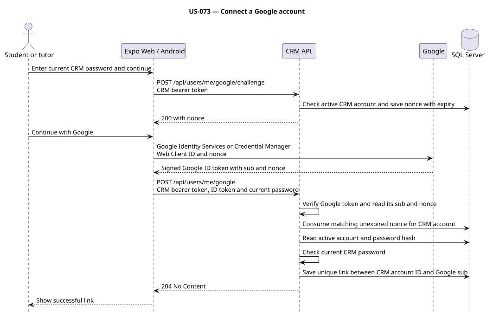

# US-073 — Integrate Google with CRM authentication

> As a student or tutor, I want to link a Google account to my existing CRM account and use Google to sign in to that account.

Related [issue #167](https://github.com/JStec0312/Tutoring-CRM-System/issues/167).

## Scope

Signed-in tutors link Google directly on `/tutor/profile` under **Połącz konto Google**. Signed-in students open **Connect Google account** from the student portal. Linking is supported on Expo Web and Android. Each CRM account can link one Google account. Google sign-in remains planned in issue #167.

## FILES

- [CreateGoogleChallenge](../../../../../TutoringManagementSystem/Tutoring.Api/Features/Auth/CreateGoogleChallenge/), [LinkGoogleAccount](../../../../../TutoringManagementSystem/Tutoring.Api/Features/Auth/LinkGoogleAccount/) and [Google ID token verifier](../../../../../TutoringManagementSystem/Tutoring.Infrastructure/Authentication/Google/GoogleIdTokenVerifier.cs).
- [Tutor profile screen](../../../../../mobile/src/features/tutor/profile/components/profile-screen.tsx), [Google controls](../../../../../mobile/src/features/tutor/profile/components/ConnectGoogleAccountButton.tsx), [linking hook](../../../../../mobile/src/features/tutor/profile/hooks/use-google-account-link.ts) and [API calls](../../../../../mobile/src/features/tutor/profile/api/google-account-link.ts).
- The [student linking route](../../../../../mobile/src/app/%28app%29/connect-google.tsx) uses the linking flow from the same profile module.
- [SQL Server integration tests](../../../../../TutoringManagementSystem/Tutoring.IntegrationTests/Features/Auth/LinkGoogleAccount/GoogleAccountLinkTests.cs) and [mobile API tests](../../../../../mobile/tests/features/tutor/profile/google-account-link.test.ts).

## API

| Method | Endpoint | Authorization | Request | Success |
| --- | --- | --- | --- | --- |
| POST | `/api/users/me/google/challenge` | CRM bearer token | Empty body | `200 OK` with `{ "nonce": "..." }` |
| POST | `/api/users/me/google` | CRM bearer token | `{ "idToken": "..." }` | `204 No Content` |

Both endpoints require a CRM access token and derive the account ID from its `sub`. The link request body contains only the Google `idToken`, which is required and limited to 8,192 characters. Both endpoints use `Cache-Control: no-store` on success.

| Status | ProblemDetails code | Condition |
| --- | --- | --- |
| `401` | — | Missing or invalid CRM authentication |
| `403` | `Auth.InactiveAccount.` | CRM account is missing or inactive |
| `400` | — | Invalid request body, including a missing `idToken` |
| `400` | `Auth.InvalidGoogleCredential` | Invalid Google token or expired, used or unmatched nonce |
| `409` | `Auth.GoogleLinkConflict` | CRM account or Google subject is already linked |
| `503` | `Auth.GoogleUnavailable` | Google Web Client ID is missing or verification keys cannot be fetched |

## Implementation

1. On screen entry, the profile module requests a challenge using the current CRM session. The API checks that the account is active and stores a random, 64-character nonce for that account for five minutes.
2. The frontend renders the official Google button. Expo Web passes the nonce to Google Identity Services and Android passes it to Credential Manager. After account selection, the frontend sends the returned Google ID token to the API using the same CRM session, without asking for the CRM password.
3. The API verifies the Google token's signature, issuer, audience and expiry, then reads the Google `sub` and `nonce`. A conditional SQL delete consumes the matching, unexpired challenge for the CRM account. The API checks that the account is still active and saves the link from `AccountId` to `GoogleSubject`. SQL Server enforces uniqueness on both identifiers.
4. After `204 No Content`, the app shows confirmation on the current screen. **Try again** requests a fresh challenge after an expired attempt. The frontend discards results from an outdated CRM session.

The `AddGoogleSignInChallenges` and `AddGoogleAccountLinks` migrations create the challenge and link tables.

### Local setup

1. Set `EXPO_PUBLIC_GOOGLE_WEB_CLIENT_ID` in `mobile/.env.local` to the OAuth **Web application** client ID. Use the same ID as `GOOGLE_WEB_CLIENT_ID` for the Compose API, or `GoogleSignIn__ClientId` when running the API directly.
2. For web development, register the exact Expo web origin in **Authorized JavaScript origins** on the Web client. For the default local port, add `http://localhost` and `http://localhost:8081` as separate entries. For a Google `401 invalid_client` reporting `no registered origin`, check the Web client's exact ID against Expo's configuration and compare the scheme, host and port with the browser address.
3. For Android, register the package set in [app.json](../../../../../mobile/app.json) and the SHA-1 fingerprint of the certificate used to sign the development APK. Rebuild the development client after installing the native dependencies.

From `mobile`:

```sh
npx expo start --web
npx eas-cli@latest build --platform android --profile development
```

After installing the development APK, run `npx expo start --dev-client` to serve the JavaScript. Sign in to CRM and use the Google button on `/tutor/profile` or open **Connect Google account** from the student portal. Select a Google account and check for confirmation on the current screen. [Google web setup](https://developers.google.com/identity/gsi/web/guides/get-google-api-clientid) · [Expo Android setup](https://docs.expo.dev/guides/google-authentication/)

## Diagram



[PlantUML source](diagrams/google_account_linking.puml)

## Tests

- Backend HTTP integration tests use the SQL Server fixture and a substitute Google verifier. They cover authorization, challenge expiry and ownership, missing ID token, account status, concurrent replay, persisted links and conflicts.
- Mobile Vitest tests check bearer authentication, both request contracts, malformed challenge responses and messages after credential or link conflicts.
- Real Google OAuth verification requires a configured Web client and a Google account. Android verification also requires the signed development APK.
