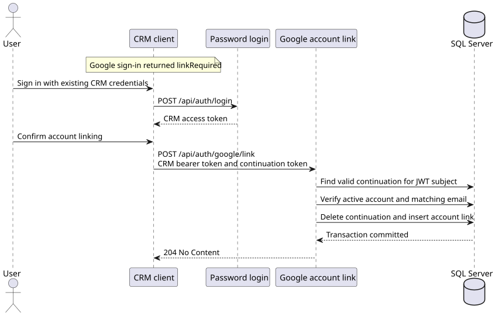

# US-073 — Sign in with Google

## Scope

The backend issues a Google sign-in challenge, verifies the returned Google ID token, and issues a CRM session for an active linked account. For an unlinked Google identity, the sign-in endpoint returns a token for the next step. An authenticated CRM account can complete linking. Completing registration remains planned. [GitHub issue #167](https://github.com/JStec0312/Tutoring-CRM-System/issues/167)

## FILES

- [Challenge slice](../../../../../TutoringManagementSystem/Tutoring.Api/Features/Auth/CreateGoogleSignInChallenge/)
- [Google sign-in slice](../../../../../TutoringManagementSystem/Tutoring.Api/Features/Auth/SignInWithGoogle/)
- [Challenge integration tests](../../../../../TutoringManagementSystem/Tutoring.IntegrationTests/Features/Auth/CreateGoogleSignInChallenge/)
- [Sign-in integration tests](../../../../../TutoringManagementSystem/Tutoring.IntegrationTests/Features/Auth/SignInWithGoogle/)
- [Account linking slice](../../../../../TutoringManagementSystem/Tutoring.Api/Features/Auth/CompleteGoogleAccountLink/)
- [Account linking integration tests](../../../../../TutoringManagementSystem/Tutoring.IntegrationTests/Features/Auth/CompleteGoogleAccountLink/)
- [Account linking sequence source](diagrams/complete-google-account-link.puml)
- [Challenge sequence source](diagrams/create-google-sign-in-challenge.puml) and [sign-in sequence source](diagrams/sign-in-with-google.puml)

## API

### Issue a challenge

`POST /api/auth/google/challenge` is anonymous. An empty request returns `200 OK` with a 64-character hexadecimal `nonce` and a UTC timestamp in `expiresAtUtc`. The response includes `Cache-Control: no-store`. Malformed JSON returns `400 Bad Request`.

### Sign in with Google

`POST /api/auth/google/sign-in` is anonymous. The client sends the signed Google ID token as `idToken` in a JSON body. Successful responses use `200 OK` and `Cache-Control: no-store`.

| `status` | Response |
| --- | --- |
| `signedIn` | `accessToken` and `expiresAt`. The refresh token uses the existing HTTP-only cookie. Native apps may send `useNativeSession: true` to receive `refreshToken` and `refreshTokenExpiresAt` in JSON. |
| `linkRequired` | `continuationToken` and `continuationExpiresAtUtc` for the existing CRM account matching the verified email. |
| `registrationRequired` | `continuationToken` and `continuationExpiresAtUtc` for a verified email with no CRM account. |

An unusable ID token or challenge returns `401` with `Auth.InvalidGoogleSignIn`. An unlinked Google identity without a valid verified email returns `401` with `Auth.GoogleVerifiedEmailRequired`. An inactive CRM account returns `403` with the existing `Auth.InactiveAccount.` code. Missing configuration or unavailable Google verification returns `503` with `Auth.GoogleSignInUnavailable`.

### Confirm linking to an existing account

After `linkRequired`, the user signs into the corresponding CRM account and confirms linking. The client sends `POST /api/auth/google/link` with the CRM bearer access token and `{ "continuationToken": "..." }`. On success the endpoint returns `204 No Content`. The client can keep using its current CRM session, and subsequent Google sign-ins resolve to the linked account.

A missing or invalid CRM session returns `401`. An unknown, expired, consumed, registration-only, or mismatched continuation returns `401` with `Auth.InvalidGoogleLinkContinuation`. An inactive CRM account returns `403` with `Auth.InactiveAccount.`. An existing link for either account returns `409` with `Auth.GoogleAccountLinkConflict`. An invalid request body returns `400`.

## Implementation

Configure the expected Google OAuth client ID using `GoogleSignIn__ClientId`. Google verification checks the signature, issuer, audience and expiry. The handler atomically consumes the signed nonce and persists either the CRM refresh token or a continuation. The challenge expires five minutes after issuance.

A linked account is resolved using the case-sensitive Google subject. The database enforces one link per Google subject and one link per CRM account. An unlinked subject can only receive a continuation. The continuation is valid for five minutes and is stored by its SHA-256 hash together with the verified Google identity, information about whether Google is authoritative for the email, and, for linking, the target CRM account ID. The linking handler reads the CRM account from the access token, checks the current account status and email, and consumes the continuation in the same transaction that inserts the link. The database uniqueness constraints resolve conflicts between concurrent requests.

## Tests

The SQL Server integration tests cover challenge issuance and cleanup, linked-account sign-in over web and native transports, both continuation paths, concurrent replay, expired challenges, invalid tokens, unavailable verification, missing verified email and inactive accounts. Sign-in integration tests substitute the Google verifier to exercise the CRM transaction without calling Google.

Account linking tests cover the flow from Google continuation through later Google sign-in, anonymous and wrong-account access, unusable continuations, both uniqueness constraints, and concurrent consumption.
