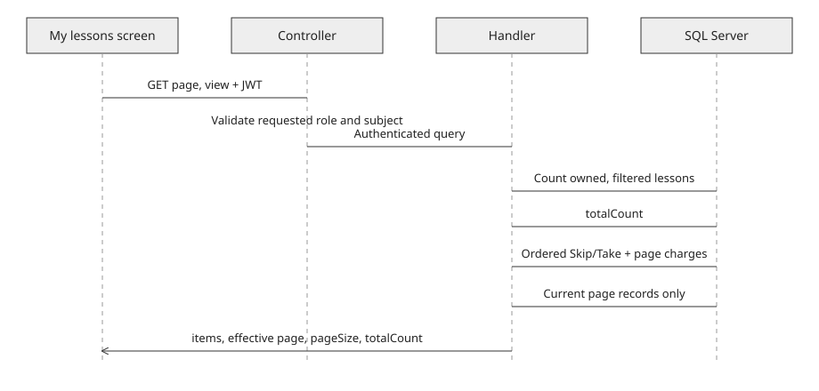

# My lessons — tutor and student

Both workspaces expose a paginated My lessons screen. The [student wireframe](https://www.figma.com/design/QVyHQq9rKy4uUENkMgiVeL/Tutoring-Wireframes?node-id=5-642) and [tutor wireframe](https://www.figma.com/design/QVyHQq9rKy4uUENkMgiVeL/Tutoring-Wireframes?node-id=4-456) use the same editable lesson-row component, with role-specific actions.

## UI and navigation

- `/student/lessons` and `/tutor/lessons` show four lessons per page, lesson dates and local times, the other participant, subject, optional planned topic, lesson status and actual charge/payment state.
- All lessons and Past lessons sort by descending start time. Upcoming sorts by ascending start time. Ties use the lesson ID for stable paging.
- Upcoming includes Scheduled lessons whose end time has not passed. Past includes lessons that ended or are no longer Scheduled, including future cancellations. All includes every owned lesson.
- The URL stores `page`, `view` and optional `agreementId`. Changing the view resets the page to one. Previous/Next use the effective page returned by the API, so a stale out-of-range link can recover.
- Materials and the lesson subject open the existing lesson details. Cancel is available only while Scheduled and opens the existing reason/confirmation form.
- Only tutors see Mark as paid, and only when the lesson has an active unpaid charge. The existing tutor payment endpoint records only those unpaid charge IDs; the list reloads on success and reports failures without assuming payment succeeded. Students see status only and have no payment mutation path.
- No charge record means Not charged; it does not imply an unpaid debt or a free cancellation. Charge amounts and Paid/Unpaid labels come from actual active billing records, not the agreement rate estimate.

The navigation no longer has a stand-alone Materials destination. Lesson details show attached files and unassigned material records from the same agreement, allow uploads, and preserve the originating lesson when an upload, attachment or deletion form returns. Files attached to another lesson are excluded. Tutor delete permissions remain unchanged; students have no delete action.

Old `/student/materials` and `/tutor/materials` bookmarks redirect to the lesson given by `lessonId`, or to My lessons with the optional agreement filter. Existing upload/attach/delete route URLs remain available as lesson workflows. Agreement-level unassigned files remain accessible from any lesson in the same agreement.

## Structure

Role-specific screens remain in `features/student/lessons` and `features/tutor/lessons`. Shared request types, paging state and the responsive list live in `shared/lessons`. Existing query/mutation hooks, session-aware API client, buttons, lesson details and material forms are reused. There are no new application dependencies.

## Paginated read API

`GET /api/lessons?page=1&pageSize=4&view=all&tutorOnly=false`

| Parameter | Default | Validation and meaning |
| --- | --- | --- |
| `page` | `1` | Integer >= 1. Values beyond the last page are clamped to the last page; an empty result uses page 1. |
| `pageSize` | `4` | Integer from 1 to 50. The current UI uses 4. |
| `view` | `all` | `all`, `upcoming` or `past`. |
| `tutorOnly` | `false` | `true` requires Tutor and scopes by `Agreement.Tutor.UserAccountId`. `false` requires Student and scopes by `Agreement.Student.UserAccountId`. |
| `agreementId` | absent | Optional agreement filter applied inside the caller's role and ownership scope. |

The response is `{ items, page, pageSize, totalCount }`. Each item contains lesson/agreement IDs, subject, planned topic, UTC start/end, status, cancellation reason, student display name, tutor first/last names, and `charges: [{ chargeId, lessonId, amount, currency, paidAtUtc }]`.

The handler counts owned/filtered lessons and uses ordered Skip/Take before materializing records. A separate no-tracking query loads only active charges for those page lesson IDs, and verifies that each billing account and lesson belong to the same agreement. Private agreement notes and tutor progress observations are excluded. CancellationToken reaches all database operations and TimeProvider determines the filter boundary. There is no schema migration.

Unauthenticated or invalid JWT subjects return 401; a workspace without the corresponding role returns 403. Invalid query parameters return 400. A missing or foreign agreement filter returns an empty page, following the calendar filter's non-disclosing behavior. Tutor and student ownership are kept separate even for accounts with multiple roles.

## Sequence

[PlantUML source](diagrams/lesson-page.puml).

## Verification

- [GetMyLessonsTests](../../../TutoringManagementSystem/Tutoring.IntegrationTests/Features/Lessons/GetMyLessons/GetMyLessonsTests.cs) covers bounded/stable pages, clamping, empty results, role checks, foreign data, filters, validation, topics, actual charges and rejection of student payment mutation.
- [lesson-list.test.tsx](../../../mobile/tests/features/lessons/lesson-list.test.tsx) covers URL paging/filter changes, student read-only payments, tutor payment payload/reload/error behavior, and lesson-scoped material visibility.
- Chrome checks use controlled API responses to verify both roles, page/filter transitions, retry after an API error, upload/attachment returns, legacy redirects and narrow-screen layout. These checks are separate from SQL Server integration tests and do not establish a live development-database session. Native Android/iOS execution is not covered by the web checks.
