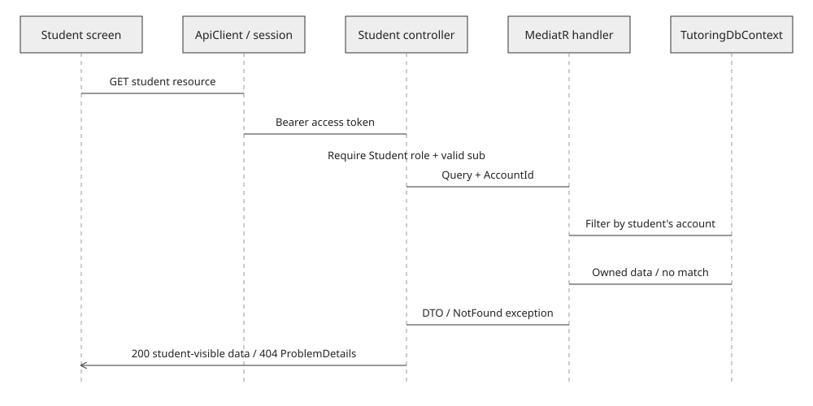

# Student workspace

The Expo application implements the student screens S01–S06 and shared screens C01–C02 from [Tutoring Wireframes](https://www.figma.com/design/QVyHQq9rKy4uUENkMgiVeL/Tutoring-Wireframes?node-id=5-236).

## Structure

Routes live in [`mobile/src/app/(app)/(student)`](<../../../mobile/src/app/(app)/(student)/>). Screen code is grouped by use case under [`features/student`](../../../mobile/src/features/student): `overview`, `calendar`, `tutors`, `lessons`, `lesson`, `payments`, `materials`, `notifications`, `profile`, and `workspace`. Each feature owns its components, API functions and any required models, following the tutor workspace structure.

The student layout wraps its routes in `StudentWorkspace`. The authenticated app layout protects the entire student route group. Shared session handling and `ApiClient` supply authentication and refresh behavior. Common controls, profile/password forms, query/mutation hooks, material operations, file saving, and the agreement lesson picker are reused. Screens contain no demo data.

## Screens and interactions

| Route | Behavior |
| --- | --- |
| `/student` | Next scheduled lesson within a year, agreement-specific outstanding amounts, and a link to My lessons. Agreements without lessons remain visible. |
| `/student/calendar` | Local-time day/week/month views, previous/next/today navigation, tutor/subject filters, and lesson navigation. The client sends UTC range boundaries without tutor-only filters. |
| `/student/tutors` | Tutor agreements, rates and statuses; selecting an agreement loads its lesson history. |
| `/student/lessons/{lessonId}` | Current schedule, planned topic, status, optional rate estimate and cancellation reason; agreement-level and lesson-specific shared materials. |
| `/student/lessons/{lessonId}/cancel` | Required reason, separate review and confirmation steps, duplicate-submit protection, API error feedback, and refreshed lesson details. |
| `/student/payments` | Actual active charges for the selected agreement, paid/unpaid state and separate outstanding totals for each currency. Payment editing stays with the tutor. |
| `/student/lessons` | Paginated lessons with All/Upcoming/Past filters, payment status, materials and cancellation actions. No student payment mutation. |
| `/student/materials` | Legacy redirect to My lessons or the specified lesson. Upload and attachment workflows are opened from lesson details. |
| `/student/notifications` | Upcoming scheduled lessons and cancelled lessons with lesson dates within seven days either side of today. Dates shown are lesson dates. This is a current-calendar summary, not a persisted notification inbox. |
| `/student/profile` | Shared first-name, last-name and phone forms, password change and sign-out. Separate name fields follow the existing profile API. |

Desktop uses the wireframe sidebar and tables. Narrow screens use bottom navigation and labeled record cards so actions remain visible without horizontal table scrolling. Navigation links expose the current page. Headings, form labels, errors, loading status and accessible action names use React Native accessibility properties that also work on web.

## Backend additions

All added endpoints require the `Student` role and a valid JWT `sub`. Ownership is based on `agreement.Student.UserAccountId`; being a tutor on an agreement does not grant access through these endpoints.

| Method | Endpoint | Response |
| --- | --- | --- |
| GET | `/api/students/me/agreements` | Array of `{ agreementId, title, subject, status, tutorFirstName, tutorLastName, hourlyRate, currency }`. Includes agreements without lessons. |
| GET | `/api/students/me/agreements/{agreementId}/lessons` | Array of `{ lessonId, tutoringAgreementId, subject, startsAtUtc, endsAtUtc, status, plannedTopic, cancellationReason }`, newest first. |
| GET | `/api/students/me/lessons/{lessonId}` | Lesson fields above plus tutor names, `estimatedAmount` and `currency`. The estimate uses the current agreement rate and duration; actual charges come from the charges endpoint. |
| GET | `/api/students/me/agreements/{agreementId}/charges` | Array of active `{ chargeId, lessonId, startsAtUtc, amount, currency, paidAtUtc }` records, newest lesson first. |

All lists are read-only, use no-tracking queries and accept request cancellation. There is no database schema change. A missing billing account or an owned agreement without lessons returns an empty list. Foreign and missing resources both return 404, with `Students.AgreementNotFound` for agreement reads and `Lessons.NotFoundForUser` for lesson details. Authentication failures return 401; wrong roles return 403; malformed route GUIDs do not match these endpoints. No private agreement notes, tutor progress observations, storage paths or another student's records are returned.

The UI does not label charges as overdue because the read contract contains no due date. It shows paid/unpaid states. Notification delivery times and reschedule event history are unavailable in the existing API; the screen presents current lesson reminders and cancellations with links to current details. Material and cancellation mutations reuse the existing participant-scoped endpoints.

## Sequence

[PlantUML source](diagrams/student-workspace.puml).

## Verification

- [`StudentWorkspaceTests`](../../../TutoringManagementSystem/Tutoring.IntegrationTests/Features/Students/StudentWorkspace/StudentWorkspaceTests.cs): student ownership, missing/foreign resources, role/authentication checks, rates, topics, cancellation reasons, empty lists, actual paid/unpaid charges and agreement isolation.
- [`student-api.test.ts`](../../../mobile/tests/features/student/student-api.test.ts): student calendar boundaries, overview aggregation, separate currencies, notification filtering, request errors and file constraints.
- [`student-flows.test.tsx`](../../../mobile/tests/features/student/student-flows.test.tsx): cancellation confirmation and errors, agreement switching, and query retry behavior.

Browser verification uses controlled API responses separately from backend integration tests; it does not establish a live browser-to-development-database session. Native Android/iOS execution is not covered by the web checks.

See [My lessons for both roles](lessons.md) for the paginated API, shared structure and updated material navigation.
